To paraphrase [a former mentor](https://en.wikipedia.org/wiki/David_Patterson_(computer_scientist)), "in academia, good graduate students are the coin of the realm." I have had the immense fortune to work with these fantastic students and postdocs, and am always looking to add more talented and hard-working students to my group.

#### Current

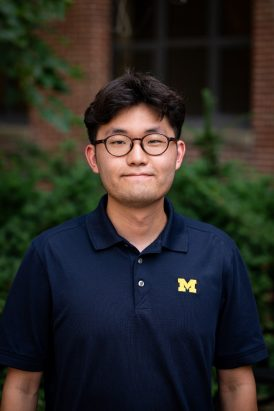
Jiatong (Kevin) Liang (2023–)

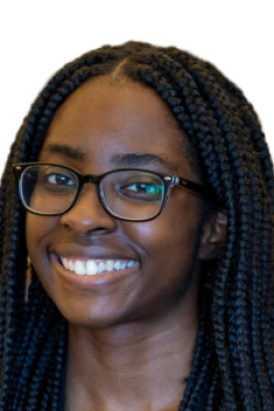
Alexis Edozie (2023–)

<a href="https://hanbin973.github.io">
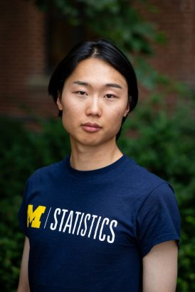
Hanbin Lee</a> (2024–)

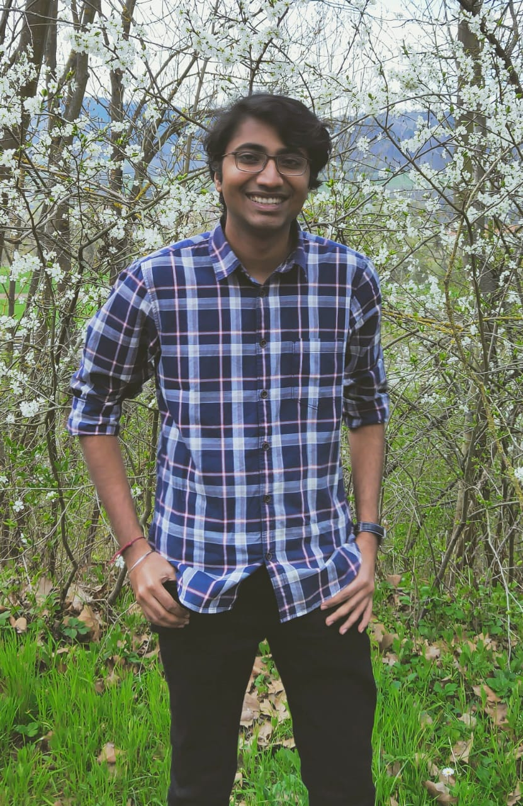
Puneeth Deraje (postdoctoral scholar; 2026–)

<a href="https://www.adway.io/">
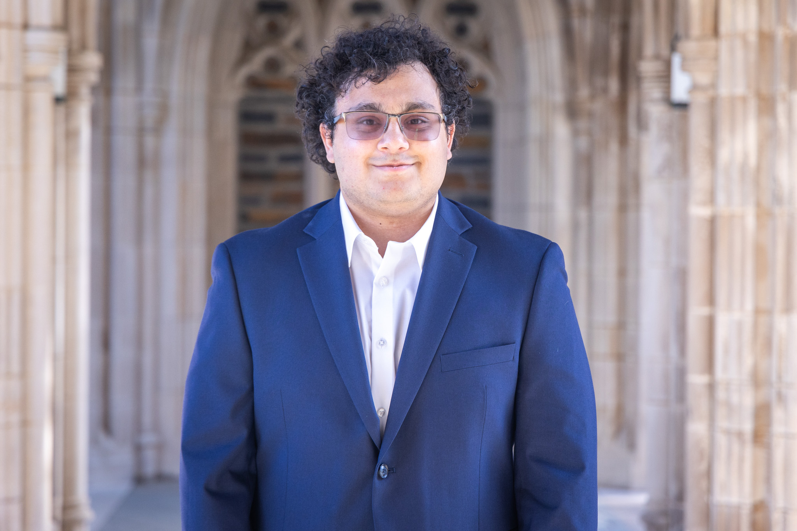
Adway Wadekar</a> (PhD student; 2025–)

#### Former

<a href="https://hfr1tz3.github.io">
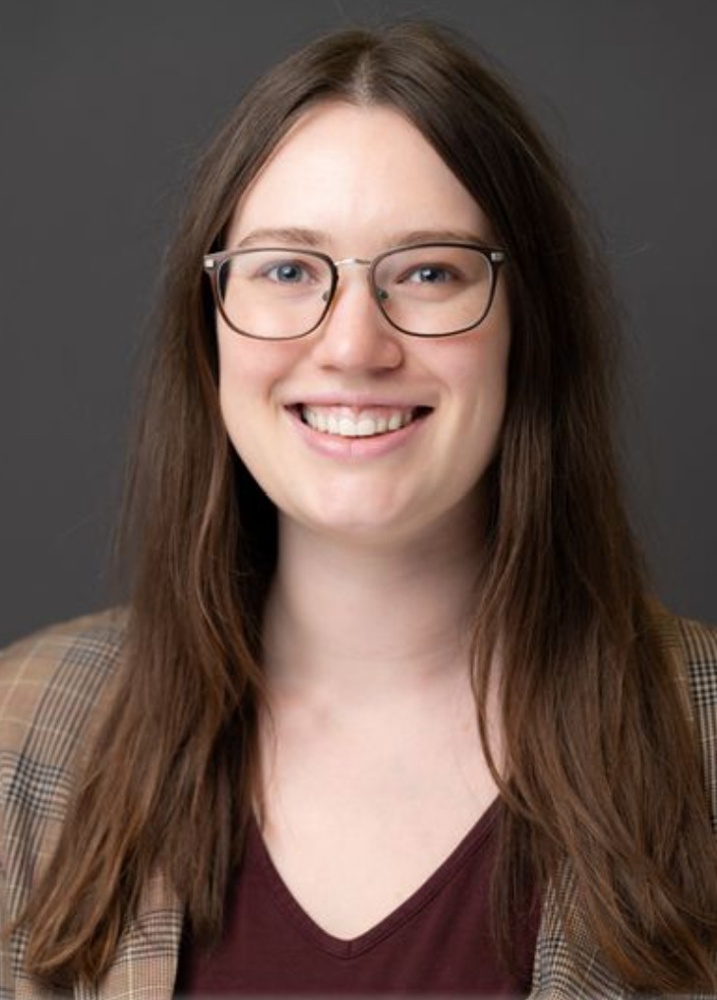
Halley Fritze</a> (postdoctoral scholar; 2025–2026). Now a Van Loo Postdoctoral Research Fellow at U-M Complex Systems.

<a href="https://sdtemple.github.io">
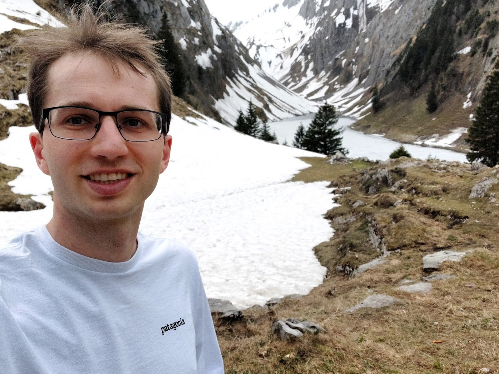
Seth Temple</a> (Schmidt AI fellow). Now a postdoctoral research associate at Los Alamos National Laboratory.

<a href="https://dodat619.github.io/">
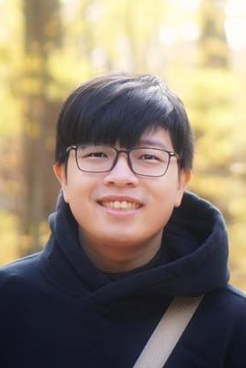
Dat Do</a> (2023–2025). Now a Kruskal Instructor at the University of Chicago.

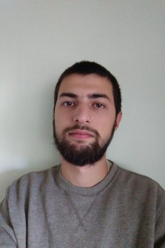
Enes Dilber (2018–2023). Off to Wayfair as a data scientist.

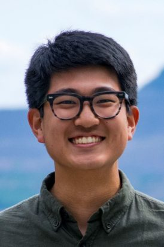
Caleb Ki (2017–2022). Off to Lyft as a data scientist.

<a href="https://sites.google.com/umich.edu/blegried/home">

Brandon Legried</a> (postdoctoral scholar; 2020–2022). Now at Georgia Tech.

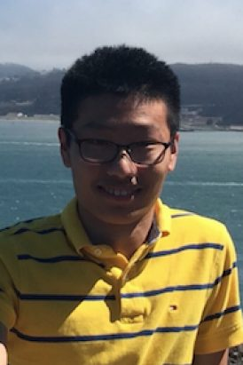
Yifan Jin (2017–2022).

