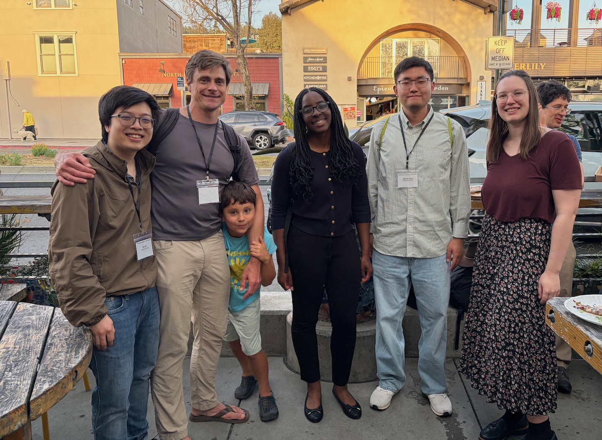

<figure class="home-photo">
  
  <figcaption>In Berkeley for ProbGen 2026!</figcaption>
</figure>

We are a group of statisticians, mathematicians, and computer scientists
broadly interested in statistical and probabilistic models of biological data. To date, our work 
has mainly centered on problems arising in evolutionary biology, but we are always keen to learn
about new areas and help other scientists understand their data. Please get in touch if this sounds like you!

### Group members

- [Jiatong (Kevin) Liang](group.html#kevin-liang)
- [Alexis Edozie](group.html#alexis-edozie)
- [Hanbin Lee](group.html#hanbin-lee)
- [Puneeth Deraje](group.html#puneeth-deraje)
- [Adway Wadekar](group.html#adway-wadekar)

[Meet the group](group.html).

### Selected recent papers

- [Linkage disequilibrium moderates how evolving genetic background shapes variant-level architecture](https://doi.org/10.64898/2026.10.01.756092) — bioRxiv preprint (2026).
- [Population-scale ancestral recombination graphs with tskit 1.0](https://doi.org/10.1038/s41592-026-03325-1) — *Nature Methods* (2026).
- [Faster inference of complex demographic models from large allele frequency spectra](https://doi.org/10.1093/bioinformatics/btag511) — *Bioinformatics* (2026).
- [Parameterizing the genetic architecture under stabilizing selection](https://doi.org/10.1093/genetics/iyag180) — *Genetics* (2026).
- [Accelerated Bayesian inference of population size history from recombining sequence data](https://doi.org/10.1038/s41588-025-02323-x) — *Nature Genetics* (2025).
- [A geographic history of human genetic ancestry](https://doi.org/10.1126/science.adp4642) — *Science* (2025).

[All publications](publications.html).

### Contact information
E-mail is the preferred method of contact: <a href="mailto:jonth@umich.edu">jonth@umich.edu</a>. Snail mail should be sent to:  
Jonathan Terhorst 
252 West Hall 
University of Michigan 
Ann Arbor, MI 48109 

### Funding
Our research is supported by the National Science Foundation (DMS-2052653) and National Institutes
of Health (R35GM151145). Thanks!

